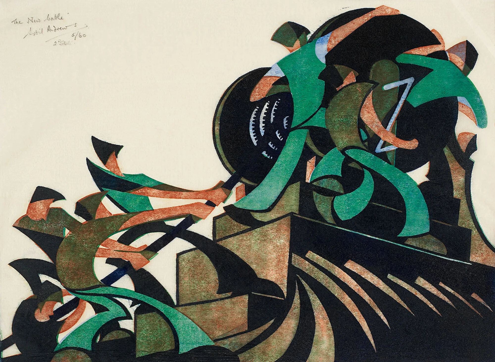

::: {#appearances}
:::

{fig-alt="LLM-created description verified by Art: A dynamic, stylized print of three muscular workers, rendered in reddish-brown, hauling a thick, massive cable. Their bodies are bent in unison along a strong diagonal line, conveying a powerful sense of rhythmic, collective labor."}
